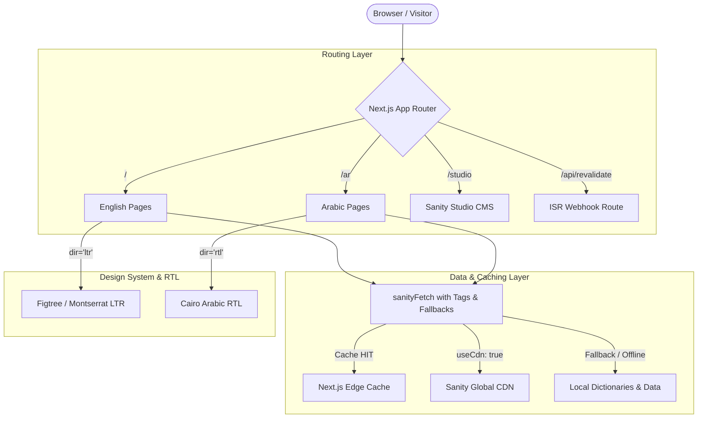

# Spec: Phase 3 — Bilingual (Arabic / RTL) & Sanity Headless CMS

## 1. Overview & Objective
Phase 3 elevates the Nairat Food Services web application into a fully bilingual, localized enterprise platform for Qatar and the GCC region. It implements:
1. **Bilingual Subpath Architecture**: English at root (`/`), Arabic at `/ar/` (`/ar`, `/ar/company`, `/ar/products`, etc.).
2. **Arabic Typography & RTL Mirroring**: Google Font **Cairo** (`subsets: ["arabic"]`), dynamic `dir="rtl"` attribute binding, and CSS logical properties.
3. **Structured Localization Dictionaries**: Typed master dictionaries (`en.ts`, `ar.ts`) with high-fidelity corporate Arabic terminology for commercial produce, cold storage, and B2B food services.
4. **Sanity Headless CMS Integration**: Embedded Sanity Studio at `/studio`, modular schemas (`product`, `service`, `company`, `partner`, `qualityCert`, `siteSettings`), tag-based Next.js data caching (`useCdn: true`), on-demand webhook revalidation (`/api/revalidate`), and resilient static fallbacks.
5. **Full-Site Verification**: Comprehensive end-to-end verification of all routes in both English and Arabic using `agent-browser`.

---

## 2. Tracer-Bullet Architecture

---

## 3. Milestones & Checklist

### Milestone 1: RTL & Bilingual Implementation
- [ ] Install / configure Google Font **Cairo** in `app/layout.tsx`.
- [ ] Register `--font-cairo` and RTL typography cascading rules in `app/globals.css`.
- [ ] Create TypeScript dictionary contracts in `lib/i18n/types.ts`.
- [ ] Create English master dictionary in `lib/i18n/dictionaries/en.ts`.
- [ ] Create high-fidelity Arabic master dictionary in `lib/i18n/dictionaries/ar.ts`.
- [ ] Create `lib/i18n/getDictionary.ts` helper.
- [ ] Implement Arabic route equivalents:
  - `app/ar/page.tsx` (Homepage)
  - `app/ar/company/page.tsx` (Company)
  - `app/ar/products/page.tsx` & `app/ar/products/[category]/page.tsx` (Products)
  - `app/ar/services/page.tsx` (Services)
  - `app/ar/quality/page.tsx` (Sourcing & Quality)
  - `app/ar/partners/page.tsx` (Partners)
  - `app/ar/contact/page.tsx` (Contact & Inquiries)
- [ ] Adapt layout components (`Navbar`, `Footer`, `Hero`, `Products`, `Strengths`, `Services`, `Cta`) with CSS logical properties and mirrored icons for RTL.
- [ ] Enable `NEXT_PUBLIC_ENABLE_LANGUAGE_TOGGLE=true` in `.env.local` and connect language toggle to counterpart routes.

### Milestone 2: Sanity Headless CMS Integration with Caching
- [ ] Create `sanity.config.ts` configured for the Next.js App Router.
- [ ] Create embedded Sanity Studio route at `app/studio/[[...tool]]/page.tsx`.
- [ ] Implement `lib/sanity/client.ts` with `useCdn: true` and cached `sanityFetch<T>({ query, tags, revalidate })`.
- [ ] Implement `lib/sanity/image.ts` image URL builder.
- [ ] Create modular schemas in `sanity/schemas/`:
  - `product.ts` (Bilingual fields, variety, storage temp, origin, image)
  - `service.ts` (Bilingual title, description, features, image, icon)
  - `company.ts` (Overview, timeline milestones, facilities)
  - `partner.ts` (Country, flag, grower lines)
  - `qualityCert.ts` (Cert title, badge, issuer, year)
  - `siteSettings.ts` (Phone, email, WhatsApp, address, office hours)
- [ ] Implement `app/api/revalidate/route.ts` with signature verification and `revalidateTag()`.
- [ ] Wire dynamic GROQ queries in `lib/sanity/queries.ts` with transparent static fallbacks.

### Milestone 3: Full-Site Verification & Testing
- [ ] Run `npx tsc --noEmit` and `npm run build` to verify clean build.
- [ ] E2E test `/` and `/ar` on Desktop and Mobile with `agent-browser`.
- [ ] Verify RTL layout mirroring, typography, form submission in Arabic, and Studio accessibility.
- [ ] Verify HTTP 200 responses and cache efficiency.
